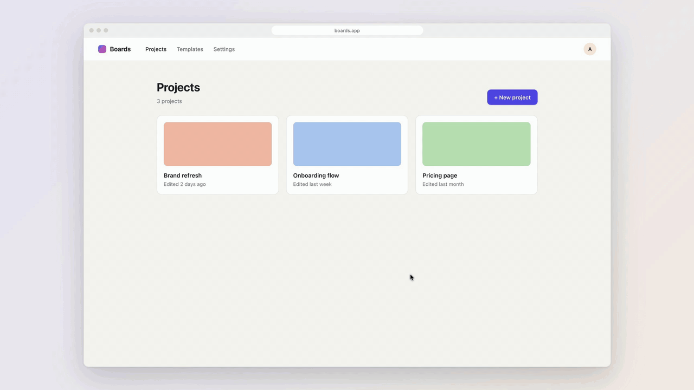

# Take

Describe a demo video in plain words. Take plays it in your real web app and gives you a finished video.



You write a few lines: the app's address and the steps (*click "New project", type "Moodboard", click "Create"*). Your AI agent tries the steps in the app, shows you a storyboard with one picture per step, and after you say yes, Take records it:

- **Real app, real frames.** Every frame comes from the browser itself, one at a time at 60 fps, so nothing stutters, however busy the page is.
- **Finished look.** A browser window with your product's address, a soft background and shadow, a smooth cursor, a ripple on every click, a text caret while typing.
- **Seamless loop.** The video ends by fading back into its first frame, ready for a landing page or a release note.
- **Easy to change.** "Type slower", "no loop", "show the result longer", "the app changed, record it again". Ask in chat; the scenario stays in your project.

The result is a 2560×1440 H.264 MP4 at 60 fps that plays everywhere.

## Install

You need **macOS or Linux**, **[Node.js](https://nodejs.org) 24 or newer** and **ffmpeg** (`brew install ffmpeg` on a Mac). Take records with your **Google Chrome** if you have it, so the first use downloads almost nothing. Without Chrome, it downloads Chromium once (about 200 MB). If anything is missing, it tells you what to install.

### Claude Code

In your terminal:

```bash
claude plugin marketplace add 23grach/take
```

```bash
claude plugin install take@take
```

Or, inside a Claude Code session: `/plugin install take --marketplace 23grach/take`. This works the same in the terminal, the Claude desktop app's Code tab and the IDE extensions.

Claude Code doesn't update plugins from this marketplace by itself. To get a new version:

```bash
claude plugin update take@take
```

### Cursor

Open **Customize** in the sidebar, add a plugin **From GitHub Repository**, paste `https://github.com/23grach/take`, and install **Take**.

### Any other agent that reads skills

Take is a standard agent skill: the folder [`skills/take`](skills/take) with its `SKILL.md`. Copy that folder to where your agent looks for skills (for example `~/.agents/skills/take`).

## Make a video

Open your project and ask your agent:

> Make a demo video of our app at http://localhost:3000: click "New project", type "Moodboard" into Name, click "Create", and show the new card.

That's all it needs. You can also write the scenario in a file, which is handy for longer videos:

```
Title: Create a project
App: http://localhost:3000 (start with: npm run dev)
Address: boards.app
Loop: yes

Steps:
1. Click "New project"
2. Type "Moodboard" into Name
3. Click "Create"
4. The new "Moodboard" card appears
```

What happens next:

1. **Rehearse.** The agent plays the steps in the app without recording and fixes anything that doesn't work.
2. **Approve.** It shows you the storyboard (one picture per step) and asks one question: record it?
3. **Record.** Take plays the steps again at a person's pace and records every frame. The agent isn't involved anymore, so the video is exactly what was approved.
4. **Check.** Take checks the video for smoothness and a clean loop, and makes a contact sheet. You get the MP4.

Everything lives in your project, in `takes/<name>/`: `scenario.md` and `take.json` are worth keeping in git; the recordings and videos can be ignored.

### Signed-in videos

To film an app as a signed-in user, Take opens a browser window where **you** sign in yourself, then remembers that login for later videos. Or, if you're already signed in to the site in Google Chrome, Take can copy that one site's login from it: turn on remote debugging once at `chrome://inspect/#remote-debugging` and click **Allow** when Chrome asks (on a Mac, the app you run Take from needs Full Disk Access). Either way Take never sees or types your password, and records in its own clean browser window, not in your Chrome. Logins are saved on your computer in `~/.take/logins/`, readable only by you, never inside a project.

Since a signed-in video shows a real account, the agent points out personal details it sees on screen before recording.

## Not yet

Videos are always 2560×1440, with one look. Phone frames, multi-finger gestures, zoom-in camera moves and GIF export aren't there yet. Videos can only start from a page the app's address opens, signed in or not, never from filmed setup steps. Some sites with strong bot protection may still refuse to be recorded. Animations in pages embedded from other sites play too fast in a final video.

## Under the hood

The agent writes an exact `take.json`, and a script performs it. Take drives the browser with [Playwright](https://playwright.dev), freezes the page's clock and steps it 1/60 s at a time while saving frames at 1.5× resolution, and logs the cursor and clicks. A few frames behind, other browsers draw the window, cursor and ripples from that log, and ffmpeg encodes the video.

The CLI the agent uses (`node skills/take/bin/take <command>`):

| Command | Does |
|---|---|
| `take doctor` | Checks Node, the browser (your Chrome, or Take's Chromium) and ffmpeg, and says what to install |
| `take validate <take.json>` | Checks the take and explains any problems |
| `take probe <take.json>` | Plays the steps without recording and makes the storyboard |
| `take run <take.json>` | Records, composes and checks the video |
| `take compose <capture>` | Composes again without re-recording (for example, a new address) |
| `take check <video.mp4>` | Checks smoothness, length and the loop, and makes a contact sheet |
| `take login <url>` / `take logout <name>` | Saves or forgets a login |

Formats: [scenario](skills/take/docs/scenario-format.md) (what you write) · [take.json](skills/take/docs/take-format.md) (what the agent writes) · [pacing rules](skills/take/docs/pacing.md) · [review checklist](skills/take/docs/review-checklist.md).

### Working on Take

```bash
cd skills/take && npm install && npm test
```

`npm run demo` starts the small demo app the tests use, at http://127.0.0.1:4300/.

## License

[MIT](LICENSE)
